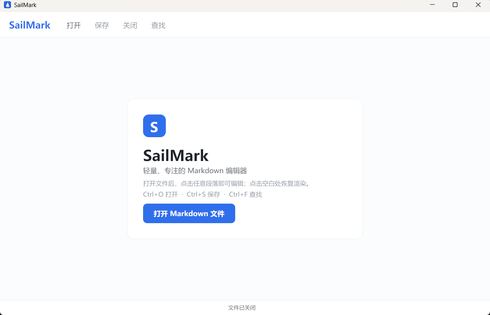
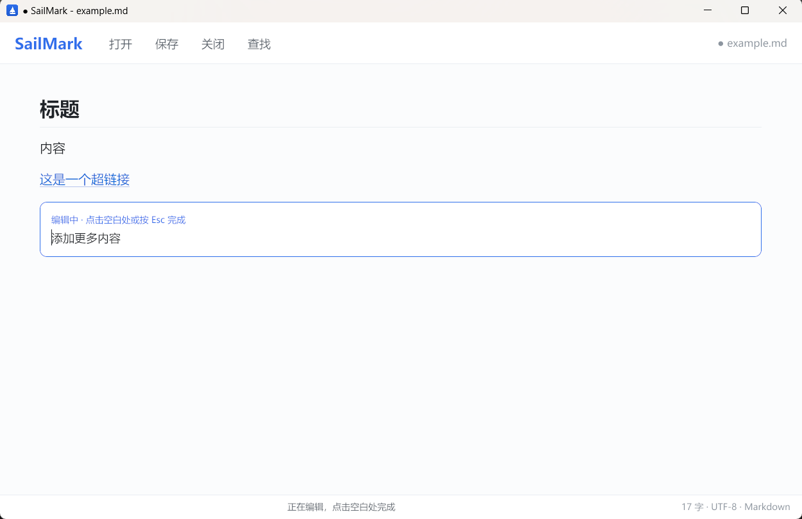
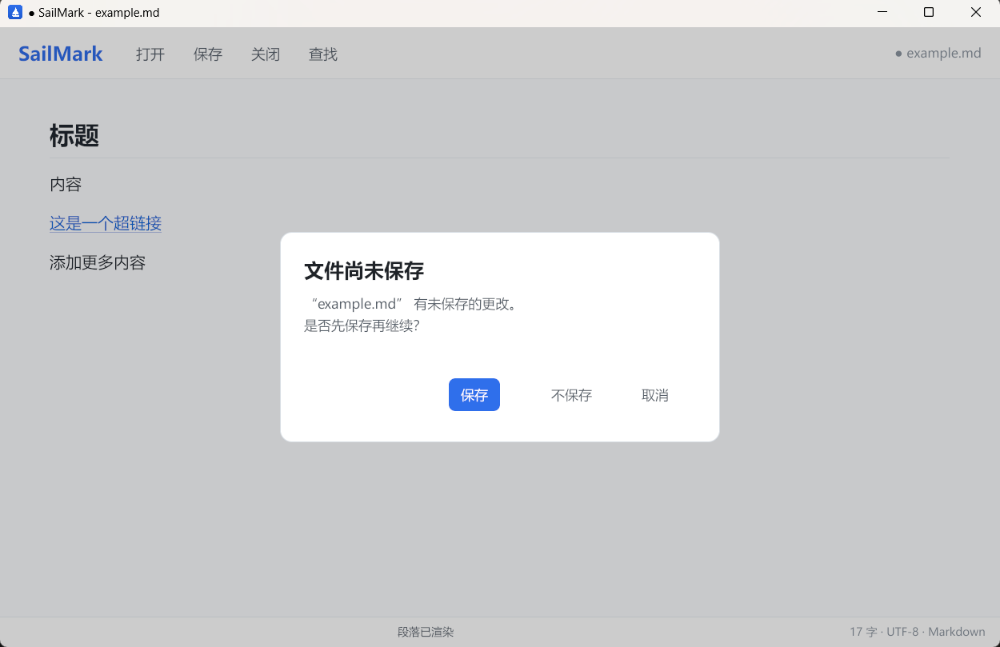
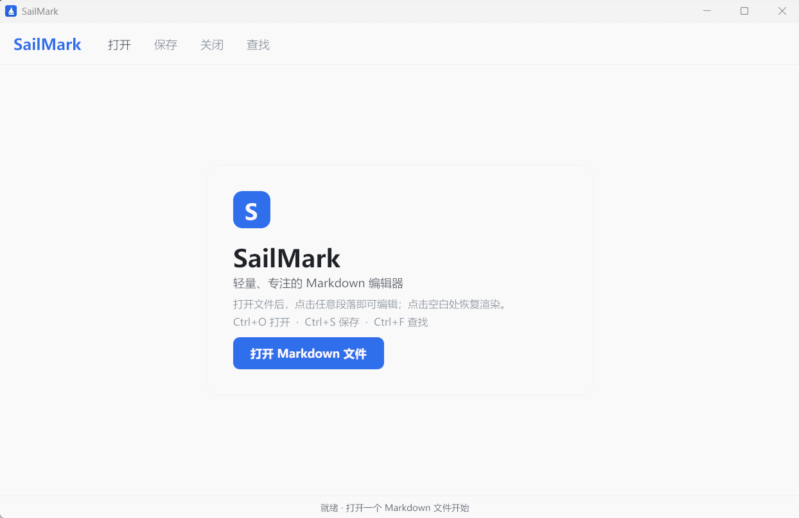

# SailMark

SailMark 是一个使用 **Go + Gio** 编写的轻量 Markdown 编辑器，交互方式接近 Typora：

打开 Markdown 文件后展示渲染后的内容；点击某个段落，该段会即时切换为显示 Markdown 源码的编辑状态；点击空白处、切换到其他段落或按 `Esc` 后，当前段落自动恢复渲染。

当前版本面向 **Windows 10/11 x64**。

## 界面预览

<p align="center">
  
  
</p>

<p align="center">
  
</p>

## 操作演示

<p align="center">
  
</p>

## 功能

- 顶部菜单只保留四个核心操作：打开、保存、关闭、查找
- 打开 Markdown 后直接显示渲染结果
- 点击段落、标题、列表、引用、代码块或表格即可就地编辑，并显示原始 Markdown 语法
- 点击空白处或另一段内容，上一段自动恢复渲染
- 编辑时新增空行会自动拆分为新的内容块
- 查找结果实时高亮，并自动滚动到当前匹配位置
- 关闭有未保存修改的文件时提示保存
- 保留原文件的 LF / CRLF 换行风格
- 支持标题、粗体、斜体、删除线、行内代码、链接、列表、任务列表、引用、代码块、表格、分隔线
- 支持本地 PNG / JPEG / GIF 图片渲染，支持相对路径、绝对路径和 file:// 路径
- 使用 Windows 原生打开 / 保存文件对话框
- 已嵌入 SailMark 图标

> 图片目前从本地文件加载；网络图片会显示提示。GIF 在编辑器内展示首帧，在 GitHub 或浏览器中可播放完整动画。

## 快速开始

1. 解压 `SailMark.zip`
2. 双击 `SailMark.exe`
3. 点击“打开”选择一个 `.md` 文件，或直接双击与 SailMark 关联的 Markdown 文件

> `SailMark.exe` 未进行代码签名，Windows SmartScreen 可能会提示。请选择“更多信息 → 仍要运行”。

## 快捷键

| 快捷键 | 功能 |
| --- | --- |
| `Ctrl+O` | 打开文件 |
| `Ctrl+S` | 保存文件 |
| `Ctrl+W` | 关闭文件 |
| `Ctrl+F` | 查找 |
| `Enter` | 查找下一个 |
| `F3` / `Ctrl+G` | 查找下一个 |
| `Esc` | 完成当前编辑 / 关闭查找 |
| `Ctrl+Enter` | 完成当前编辑 |

## 从源码构建

需要 Go 1.24 或更高版本。在项目目录执行：

```bat
build_windows.bat
```

也可以手动执行：

```bat
set GOOS=windows
set GOARCH=amd64
set CGO_ENABLED=0
go build -trimpath -ldflags="-s -w -H=windowsgui" -o dist\SailMark\SailMark.exe .
```

## 项目结构

```text
app.go        应用状态、事件、编辑与查找逻辑
ui.go         菜单、查找栏、文档视口、状态栏与对话框
render.go     Markdown 块渲染与就地编辑
markdown.go   Markdown 解析、块划分与搜索纯文本
fonts.go      系统字体加载
dialog_*      原生文件选择对话框
```

## 打赏支持

<p align="center">
  
</p>

<p align="center"><strong>自愿赠与，感谢支持！</strong></p>

上方打赏码属于**资源赠与**性质，仅用于表达对 SailMark 开源工作的**自愿、无偿鼓励与支持**。

该赠与：

- **不构成任何商品、服务、订阅、授权或其他形式的对价**
- 不代表购买任何功能、版本、服务或商业权益
- 完全自愿，是否支持不影响 SailMark 的任何功能、授权与正常使用

感谢每一位使用、反馈和帮助改进 SailMark 的朋友。

## 许可证

本项目基于 [MIT License](./LICENSE) 开源。
